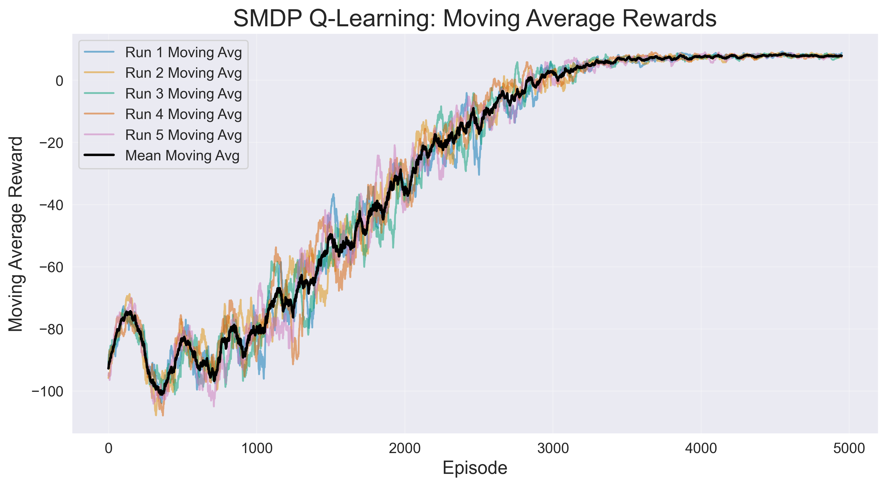
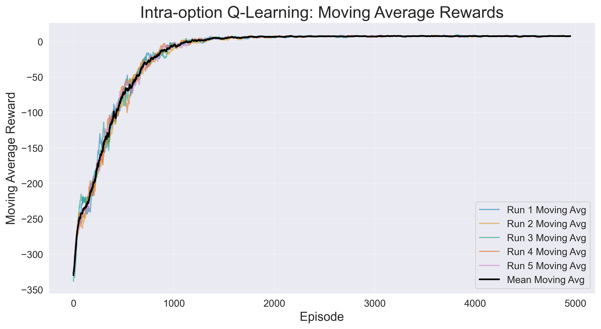
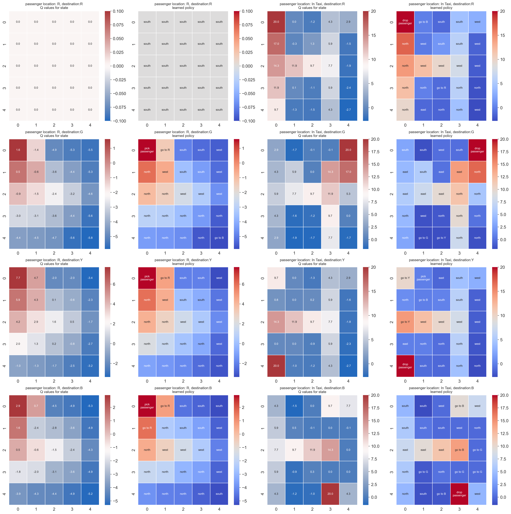
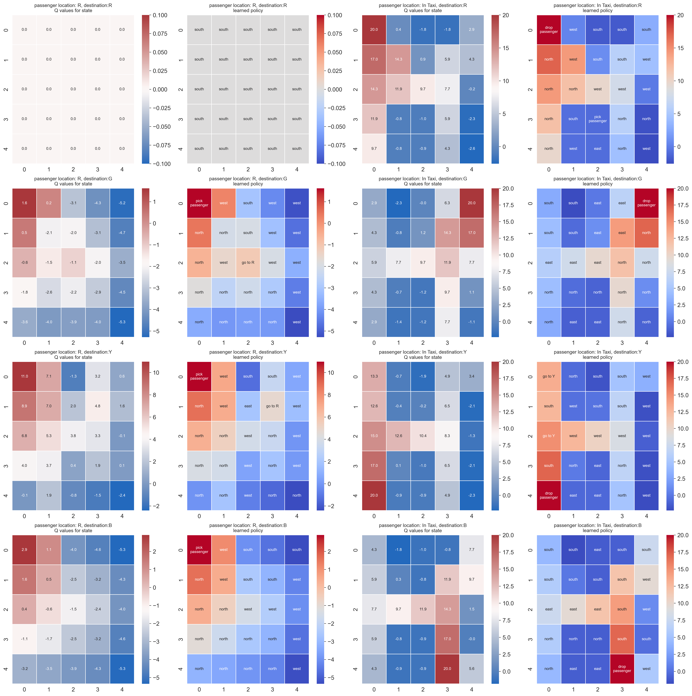

# Reinforcement Learning - Taxi Environment with SMDP and Intra-Options

## Contributions

- Aswin Balamurugan (ch20b018)
  - Implemented SMDP Q-Learning (run_smdp())
  - Developed alternate boundary options (run_alt_smdp())
  - Analyzed SMDP performance and wrote report sections
- Sanjith Balamurugan (mm20b055)
  - Implemented Intra-Option Q-Learning (run_intraoptions())
  - Developed alternate boundary options (run_alt_intraoptions())
  - Analyzed Intra-Option performance and wrote report sections
- Shared Contributions:
  - Compared SMDP vs Intra-Option performance
  - Code review and debugging
  - Submission preparation

This repository contains implementations of **Semi-Markov Decision Processes (SMDP)** and **Intra-Option Learning** in the Taxi-v3 environment from OpenAI Gym. The project explores how different options (high-level actions) can improve the learning efficiency and performance of reinforcement learning agents.

## Features

1. **SMDP Q-Learning**: Implements SMDP Q-learning with predefined navigation options.
2. **Intra-Option Q-Learning**: Implements intra-option learning, where options are learned and updated during training.
3. **Alternate Options**: Explores the use of alternate options (e.g., boundary navigation) to improve performance.
4. **Model Saving and Loading**: Saves the best models during training for later use.
5. **Visualization**: Generates plots for rewards, Q-values, and learned policies.
6. **Logging**: Logs training progress and results for analysis.

## Setup

### Installation

1. Clone the repository:

   ```bash
   git clone https://github.com/yourusername/RL-Taxi-SMDP-IntraOptions.git
   cd RL-Taxi-SMDP-IntraOptions
   ```

2. Install the required dependencies:
   ```bash
   pip install -r requirements.txt
   ```

## Usage

### Training Models

1. **Run SMDP Training**:

   ```bash
   python main.py
   ```

   This will train the SMDP model and save the best model and results.

2. **Run Intra-Options Training**:

   ```bash
   python main.py
   ```

   This will train the Intra-Options model and save the best model and results.

3. **Run Alternate Options Training**:
   ```bash
   python alternate_opt.py
   ```
   This will train both SMDP and Intra-Options models with alternate options and compare the results.

### Rendering the Best Model

To visualize the performance of the best-trained model:

1. **Render SMDP Model**:

   ```bash
   python render.py
   ```

   Select option `1` to render the SMDP model.

2. **Render Intra-Options Model**:
   ```bash
   python render.py
   ```
   Select option `2` to render the Intra-Options model.

### Comparing Results

To compare the results of different models:

1. **Compare Original and Alternate Options**:
   ```bash
   python alternate_opt.py
   ```
   Select option `4` to compare the results of original and alternate options.

## Directory Structure

```text
├── src/                     # Source code
│   ├── smdp.py              # SMDP Q-learning implementation
│   ├── intraoptions.py      # Intra-Option Q-learning implementation
│   ├── utils.py             # Utility functions (plotting, saving, etc.)
│   ├── hyperparams.py       # Hyperparameters and constants
│   └── __init__.py          # Package initialization
├── models/                  # Saved models
├── results/                 # Training results (plots, rewards)
├── logs/                    # Log files
├── alternate_opt.py         # Alternate options experiment
├── main.py                  # Main script for training
├── render.py                # Script for rendering trained models
└── README.md
```

## Results

After training, the results (rewards, plots, etc.) are saved in the `results/` directory. The best models are saved in the `models/` directory.

### Example Plots

- **Rewards Over Episodes**: Shows the moving average of rewards over training episodes.

| **SMDP Rewards**                                     | **Intra-Options Rewards**                                             |
| ---------------------------------------------------- | --------------------------------------------------------------------- |
|  |  |

- **Q-Values and Policies**: Visualizes the learned Q-values and policies for different states.

| **SMDP**                                                      | **Intra-Options**                                                      |
| ------------------------------------------------------------- | ---------------------------------------------------------------------- |
|  |  |

## Logging

Training progress and results are logged in the `logs/` directory. The logs include information about each run, such as average rewards and model performance.
